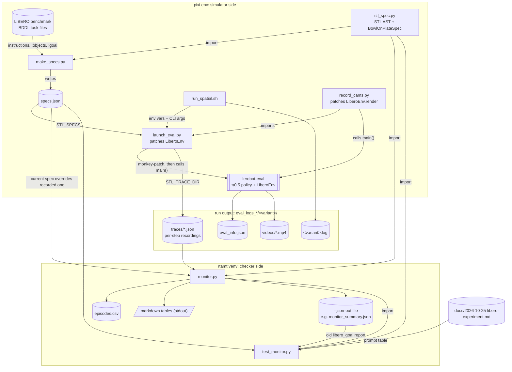

# libero_ws file architecture

This workspace runs π0.5 (`lerobot/pi05_libero_finetuned_v044`) on LIBERO with the task instruction swapped for an
STL-based prompt, records every env step, and checks the recordings offline against STL specs with rtamt.

All project code lives in `stl_prompt/`. Everything else is either the environment (`pixi.toml`, `.pixi/`) or
run output (`eval_logs*/`).

## Two Python environments

| Environment | Has | Runs |
|---|---|---|
| pixi env (`pixi run ...`, from `pixi.toml`) | LeRobot 0.6.x with the `libero` extra, LIBERO, torch, MuJoCo | `make_specs.py`, `launch_eval.py`, `record_cams.py`, `run_spatial.sh` |
| rtamt venv (`stl_repos/.venv-rtamt`) | rtamt, numpy | `monitor.py`, `test_monitor.py` |

`stl_spec.py` is plain Python with no LIBERO or rtamt import, so both sides share it.

## System graph



## Files

### `stl_prompt/stl_spec.py`: the STL specs

- **What it does:** a small STL abstract syntax tree (`Atom`, `Not`, `And`, `F` eventually, `G` always, `U` until).
  Each formula gives three views:
  - `to_rtamt()`: rtamt discrete-time text, bounds in env steps (20 Hz). Used for monitoring.
  - `to_stl()`: compact STL text, bounds in seconds. Used as the `stl` prompt.
  - `to_english()`: template English. Used as the `stl_nl` prompt.

  Atoms are LIBERO BDDL predicates (`on`, `in`, `open`, `close`, `turnon`, `turnoff`), so the simulator can
  evaluate them with `env._eval_predicate`. `NAMES` maps BDDL ids to readable names.
  The bottom half defines the libero_spatial spec, `BowlOnPlateSpec`, written directly as rtamt text because
  its predicates (grasp, rest, disturbed) aren't BDDL atoms:

  ```
  phi = (!On(b,p) U Grasp(b)) & F[0,9s] G Rest(b,p) & AND_{o in O} G[0,11s] !Disturbed(o)
  ```

  `Thresholds` holds the numeric limits (rest speed and spin, disturb displacement and tilt).
- **Input:** none (pure library).
- **Output:** Python objects and strings.
- **Used by:** `make_specs.py`, `monitor.py`, `test_monitor.py`.

### `stl_prompt/make_specs.py`: builds `specs.json`

- **What it does:** writes the spec and the prompt variants of every task.
  - libero_goal (spec kind `bddl`): one hand-written formula per task (`LIBERO_GOAL`). Prompts `nl` (original
    instruction), `stl_nl` (English from the STL), `stl` (raw STL, readable names), `stl_bddl` (raw STL, BDDL ids).
  - libero_spatial (spec kind `bowl_on_plate`): one `BowlOnPlateSpec` for all 10 tasks, with the bowl named by
    its location. Prompts `nl`, `stl_nl` (instruction + one fixed rule sentence), `stl`.

  It asserts that LIBERO's instructions and goals are what the hand-written specs assume.
- **Input:** `stl_spec.py`; LIBERO's benchmark registry and BDDL files (instruction, `:objects`, `:goal`).
- **Output:** `specs.json` (path given as the first argument); prints every prompt and rtamt formula.
- **Run:** `pixi run python stl_prompt/make_specs.py stl_prompt/specs.json`

### `stl_prompt/specs.json`: generated spec file

- **What it is:** `{"hz": 20, "libero_goal": {task_id: entry}, "libero_spatial": {task_id: entry}}`. Each entry
  has `kind`, `rtamt`, `prompts` (one string per variant), `movable` (the scene's BDDL objects) and either
  `atoms` (signal name → BDDL predicate, for `bddl`) or `bowl`/`plate`/`others`/time windows (for `bowl_on_plate`).
- **Written by:** `make_specs.py`. Don't edit by hand.
- **Read by:** `launch_eval.py` (via `STL_SPECS`), `monitor.py` (`--specs`), `test_monitor.py`.

### `stl_prompt/launch_eval.py`: the eval with prompt swap and recordings

- **What it does:** monkey-patches LeRobot's `LiberoEnv` (`__init__`, `reset`, `step`, `close`), then runs
  `lerobot-eval`'s `main()` with the same CLI.
  - `__init__`: replaces `task_description` with the `STL_VARIANT` prompt from `specs.json`.
  - `reset`: writes out the previous episode, starts a new recording, takes sample 0.
  - `step`: takes one sample per env step: 0/1 signals evaluated in the sim (BDDL atoms, or
    `on`/`grasp`/`gripper_contact` for the bowl), pose and velocity of every movable object, LIBERO's success flag.
    With `STL_NO_EARLY_STOP=1` it forces `terminated=False`, so every episode runs the suite's full length.
  - `close`: writes out the last episode.

  Only works with `eval.batch_size=1` (same process).
- **Input:** lerobot-eval CLI args; env vars `STL_SPECS` (required), `STL_VARIANT`, `STL_TRACE_DIR`, `STL_NO_EARLY_STOP`.
- **Output:** lerobot-eval's usual `<output_dir>/eval_info.json` and `videos/`; plus one recording per episode,
  `<STL_TRACE_DIR>/<suite>_<task_id>_ep<k>.json` (format 2: metadata, the spec, `signals`, `objects`, `success`).
- **Called by:** `run_spatial.sh` (libero_spatial); run directly for libero_goal. Imported by `record_cams.py`.

### `stl_prompt/record_cams.py`: same eval, video shows the policy's cameras

- **What it does:** imports `launch_eval` (so all its patches apply), then replaces `LiberoEnv.render` so each
  video frame shows every camera the policy gets (agentview and eye-in-hand), side by side and labelled,
  rotated 180° as `LiberoProcessorStep` does.
- **Input:** same CLI and env vars as `launch_eval.py`.
- **Output:** same as `launch_eval.py`, but the videos are multi-camera. Used for `eval_logs_cams/`.

### `stl_prompt/run_spatial.sh`: one libero_spatial run

- **What it does:** runs `launch_eval.py` for one prompt variant on all 10 libero_spatial tasks with fixed settings
  (π0.5 LIBERO checkpoint, `n_action_steps=10`, batch size 1, seed 1000, no early stop, recordings on).
- **Input:** `<variant> <gpu> <n_episodes_per_task> <out_root>`; reads `stl_prompt/specs.json`.
- **Output:** `<out_root>/<variant>/{eval_info.json, videos/, traces/}` and `<out_root>/<variant>.log`.
- **Run (from `libero_ws/`):** `stl_prompt/run_spatial.sh nl 0 10 eval_logs_stl_spatial`

### `stl_prompt/monitor.py`: offline STL checker

- **What it does:** loads every recording in the given trace dirs and checks it with rtamt.
  - `load_trace`: reads a recording and upgrades format 1 (the first libero_goal run) to format 2. For format 2 it
    checks against the current `specs.json` entry, not the copy saved at run time, so a spec change needs no rerun.
  - `check_goal` (kind `bddl`): `task_rob` (robustness), `stl_sat`, LIBERO success, `moved` (other objects moved
    more than 5 cm), `clean`, and the spec with tightened deadlines (5 s, 10 s).
  - `check_spatial` (kind `bowl_on_plate`): derives speed, spin, displacement and tilt signals from the recorded
    poses, then checks `grasp_first`, `deadline`, `no_move_<o>`, `undisturbed`, `clean`, `full_stl`, plus the
    older `*_moved5` and `*_rest2s` versions and diagnostics.

  Every verdict is computed twice, by rtamt and by plain numpy, and any disagreement is printed.
  Thresholds, the velocity source (`--vel sim|pose`) and the grasp definition (`--grasp-lift`) are CLI options.
- **Input:** one or more `<run>/<variant>/traces` dirs; `specs.json` (`--specs`); `stl_spec.py`.
- **Output:** `<run>/<variant>/episodes.csv` for libero_spatial (or `episodes_grasp_lift_<x>.csv`), unless
  `--no-write`; markdown summary tables with Wilson intervals on stdout; all rows as JSON with `--json-out`
  (this is how `eval_logs_stl/monitor_summary.json` was made).
- **Run (rtamt venv):** `python stl_prompt/monitor.py eval_logs_stl_spatial/{nl,stl_nl,stl}/traces`

### `stl_prompt/test_monitor.py`: tests for the checker

- **What it does:** builds hand-made 281-sample libero_spatial recordings from a clean baseline, breaks one part of
  phi per test, and checks that rtamt and numpy both give the expected verdict. Also checks:
  - the rtamt text of `BowlOnPlateSpec` against the form written in the experiment doc;
  - the libero_spatial prompts in `specs.json` against the prompt table in `docs/2026-10-25-libero-experiment.md`;
  - that re-checking the saved libero_goal recordings reproduces `eval_logs_stl/monitor_summary.json`
    (skipped if those recordings are missing).
- **Input:** `monitor.py`, `stl_spec.py`, `specs.json`, the experiment doc, `eval_logs_stl/`.
- **Output:** `PASS`/`FAIL` per test; exit code 1 on any failure.
- **Run (rtamt venv):** `python stl_prompt/test_monitor.py`

### `pixi.toml` / `pixi.lock` / `.pixi/`

The pixi environment: Python 3.12, `lerobot[libero,pi,evaluation]` 0.6.x, torch 2.7.1 (CUDA 11.8). `.pixi/` is the
installed env and is git-ignored.

## Output folders

| Folder | Made by | Contents |
|---|---|---|
| `eval_logs/`, `eval_logs2/` | plain `lerobot-eval` | Early baseline runs: `eval_info.json`, `videos/`. No recordings |
| `eval_logs_stl/` | `launch_eval.py`, libero_goal | `<variant>/{eval_info.json, videos/, traces/}` for `nl`, `stl_nl`, `stl`, `stl_bddl`; `<variant>.log`; `monitor_summary.json` from `monitor.py --json-out`. Recordings are format 1 |
| `eval_logs_stl_spatial/` | `run_spatial.sh`, libero_spatial | `<variant>/{eval_info.json, videos/, traces/, episodes.csv, episodes_grasp_lift_0.02.csv}` for `nl`, `stl_nl`, `stl` |
| `eval_logs_cams/` | `record_cams.py` | `nl/{eval_info.json, videos/, traces/}` with multi-camera videos |

## End-to-end flow

1. `make_specs.py` (pixi) → `specs.json`.
2. `run_spatial.sh <variant> ...` (pixi) → `launch_eval.py` → `lerobot-eval`, once per prompt variant →
   `eval_logs_stl_spatial/<variant>/traces/*.json`.
3. `monitor.py` (rtamt venv) on the trace dirs → `episodes.csv` + summary tables.
4. `test_monitor.py` (rtamt venv) guards the checker and the prompt table.
