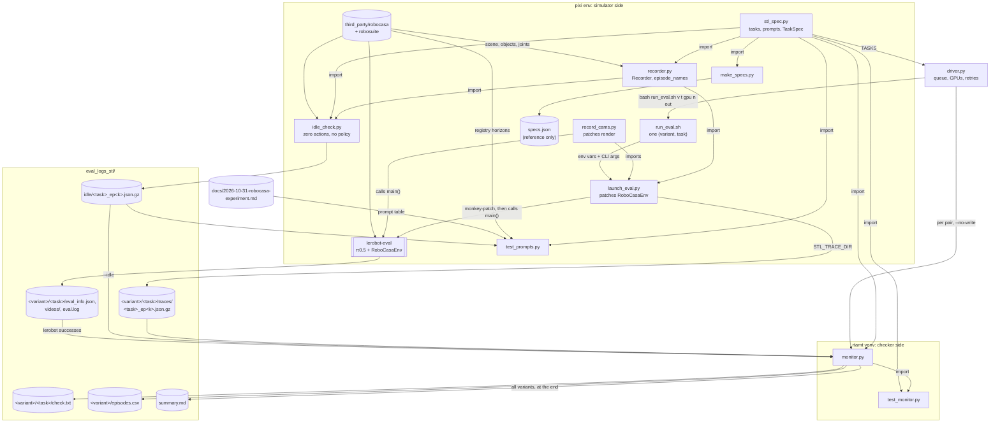

# robocasa_ws file architecture

This workspace runs π0.5 (`lerobot/pi05_robocasa`) on the 18 RoboCasa365 `atomic_seen` tasks with three prompt
variants (`nl`, `stl_nl`, `stl`), records every env step, and checks the recordings offline against one STL spec
shape with rtamt. The experiment is described in `docs/2026-10-31-robocasa-experiment.md`.

All project code lives in `stl_prompt/`. `third_party/` holds the RoboCasa and robosuite checkouts (unmodified;
git-ignored). Everything else is the environment (`pixi.toml`, `.pixi/`) or run output (`eval_logs*/`).

## Two Python environments

| Environment | Has | Runs |
|---|---|---|
| pixi env (`pixi run ...`, from `pixi.toml`) | LeRobot 0.6.x, editable `third_party/robocasa` and `third_party/robosuite`, torch, MuJoCo (`MUJOCO_GL=egl`) | `launch_eval.py`, `record_cams.py`, `run_eval.sh`, `idle_check.py`, `test_prompts.py`, `make_specs.py` |
| rtamt venv (`/mnt/samsung_2tb/mingyue/stl_repos/.venv-rtamt`) | rtamt, numpy | `monitor.py`, `test_monitor.py` |
| either | plain Python | `driver.py` (calls the pixi env through `run_eval.sh` and the rtamt venv by path), `make_specs.py` |

`stl_spec.py` imports nothing from RoboCasa or rtamt, so both sides share it.

## System graph



## Files

### `stl_prompt/stl_spec.py`: tasks, prompts and the STL spec

- **What it does:** the shared definitions.
  - `TASKS`: the 18 tasks, each with its type (`P` pick-and-place, `F` fixture, `N` navigation) and RoboCasa
    horizon. The deadline `T` is 60% of the horizon in whole seconds.
  - Prompts: `prompt_names` pulls the object, part and fixture words out of RoboCasa's instruction;
    `make_prompts` returns `nl` (RoboCasa's instruction), `stl_nl` (instruction + rule sentences from
    `stl_nl_suffix`) and `stl` (raw STL from `stl_prompt`).
  - The spec, one shape for all tasks:

    ```
    phi = F[0,T] G Rest  &  AND_{o in O} G !Disturbed(o)
    Rest (P) = Success & Still(o)
    Rest (F) = Success & Released(part) & PartStill(part)
    Rest (N) = Success & BaseStopped
    ```

    `TaskSpec(task, others)` turns it into rtamt text (`to_rtamt`, `deadline_rtamt`, `undisturbed_rtamt`) and lists
    the signals it needs. `Thresholds` holds the numeric limits; signal names are the `SIG_*` constants.
- **Input:** none (pure library).
- **Output:** Python objects and strings.
- **Used by:** every other file in `stl_prompt/`.

### `stl_prompt/recorder.py`: per-step recordings

- **What it does:**
  - `episode_names(env, task)`: reads the episode's instruction and object words from the built scene and returns
    the three prompts (via `stl_spec.make_prompts`).
  - `roles(env, task)`: picks the target object, receptacle, source container and the others `O`.
  - `Recorder.start(env, seed, prompt, names)`: after each reset (the MuJoCo model is rebuilt every time), looks
    up all handles: free bodies, fixture joints, goal joints, the moving part's geoms, gripper and finger-pad geoms.
  - `Recorder.sample(success)`: appends one sample: object poses and velocities, frames (OpenDrawer's drawer box),
    fixture joint positions, goal-joint velocities, RoboCasa's success and its parts, gripper/finger-pad/robot
    contacts, grip-site position, mobile-base pose and velocity.
  - `Recorder.write(dir, name)`: gzips the recording to JSON (skips a reset that was never stepped).

  On import it also patches RoboCasa's counter-region sampler (`counter.py`'s `set`) to an order-preserving dedupe,
  so the same seed builds the same kitchen in every process. Without it, prompts can't be paired by seed.
- **Input:** a live RoboCasa env (`env.sim`, `env.objects`, fixtures); `stl_spec.py`.
- **Output:** `<dir>/<task>_ep<k>.json.gz` (format `robocasa-1`).
- **Used by:** `launch_eval.py`, `idle_check.py`.

### `stl_prompt/launch_eval.py`: the eval with prompt swap and recordings

- **What it does:** monkey-patches LeRobot's `RoboCasaEnv`, then runs `lerobot-eval`'s `main()` with the same CLI.
  - `_format_raw_obs` and `convert_action`: with `STL_IO_ORDER=dataset` (default), reorder the 16-d state and the
    12-d action to the RoboCasa365 dataset layout that `pi05_robocasa` was trained on (LeRobot 0.6.1 uses a
    different order).
  - `reset`: writes out the previous episode, builds this episode's prompts with `episode_names`, sets
    `task_description` to the `STL_VARIANT` prompt, starts a `Recorder`.
  - `step`: replaced, not wrapped, because LeRobot's version calls `reset()` on success mid-episode. Takes one
    recorder sample per step; with `STL_NO_EARLY_STOP=1` it never terminates, so every episode runs the full horizon.
  - `close`: writes out the last episode.

  Needs `eval.batch_size=1` and `eval.use_async_envs=false` (same process).
- **Input:** lerobot-eval CLI args; env vars `STL_VARIANT`, `STL_TRACE_DIR`, `STL_NO_EARLY_STOP`, `STL_SEED0`,
  `STL_IO_ORDER`.
- **Output:** lerobot-eval's `eval_info.json` and `videos/` in `--output_dir`; recordings in `STL_TRACE_DIR`.
- **Called by:** `run_eval.sh`. Imported by `record_cams.py`.

### `stl_prompt/record_cams.py`: same eval, video shows the policy's cameras

- **What it does:** imports `launch_eval` (all its patches apply), keeps each step's camera images from
  `_format_raw_obs`, and replaces `render` so each video frame shows every policy camera side by side, labelled.
- **Input:** same CLI and env vars as `launch_eval.py`.
- **Output:** same as `launch_eval.py`, with multi-camera videos. Used for `eval_logs_cams/`.

### `stl_prompt/run_eval.sh`: one (variant, task) eval

- **What it does:** runs `launch_eval.py` in the pixi env with fixed settings: `pi05_robocasa`,
  `n_action_steps=50`, `compile_model=false` (torch.compile scrambled the EGL camera images), split `pretrain`,
  object registries `objaverse` + `lightwheel`, batch size 1, seed 1000 (episode k uses seed 1000 + k), no early
  stop, recordings on, `CUDA_DEVICE_ORDER=PCI_BUS_ID`.
- **Input:** `<variant> <task> <gpu> <n_episodes> <out_root> [extra lerobot-eval args]`.
- **Output:** `<out_root>/<variant>/<task>/{eval_info.json, videos/, traces/, eval.log}`.
- **Called by:** `driver.py`; can be run by hand from `robocasa_ws/`.

### `stl_prompt/driver.py`: runs the whole grid, restartably

- **What it does:** builds the queue of (variant, task) pairs (first two variants interleaved task by task, then the
  rest), skips pairs already done, and keeps `--slots` pairs running. Each pair starts on the GPU with the most free
  memory (from `nvidia-smi`), only if at least `--need-gb` is free. A failed or incomplete pair is moved to
  `<task>.incomplete-<time>` and retried up to `--retries` times. After each good pair it runs `monitor.py` on it;
  after the last one, `monitor.py` on all variants. Logs free RAM and each eval's RSS every minute.
- **Input:** `--out --variants --tasks --episodes --slots --gpus --need-gb --retries`; `stl_spec.TASKS`.
- **Output:** the pair folders (via `run_eval.sh`), `<pair>/check.txt`, `<out>/summary.md`, log lines on stdout
  (saved as `driver.log` when run under `screen`).
- **Run (from `robocasa_ws/`, in `screen`):** `python stl_prompt/driver.py --out eval_logs_stl`

### `stl_prompt/idle_check.py`: zero-action baseline

- **What it does:** builds every (task, seed) scene the way LeRobot does, applies the zero action for the full
  horizon with no policy and cameras off, and writes the same recordings as the eval. Shows which objects move or
  "succeed" on their own, which is used to tune thresholds and to check prompts for all 180 scenes. Runs one
  subprocess per task (`--workers` at a time); `--one` runs in-process.
- **Input:** `--out --tasks --seeds (default 1000-1009) --workers --cameras --one`; RoboCasa; `recorder.py`.
- **Output:** `<out>/<task>_ep<k>.json.gz` (variant `idle`) and `<out>/<task>.log`.
- **Run:** `pixi run python stl_prompt/idle_check.py --out eval_logs_stl/idle`

### `stl_prompt/monitor.py`: offline STL checker

- **What it does:** finds every `*.json.gz` under the given dirs and checks each episode.
  - `derive_signals`: speed and spin of the target, joint velocity and gripper contact of the moving part, base
    speed and turn rate, and displacement/rotation of each `o` in `O` from its settled reference pose (`--ref settle`)
    or from t = 0 (`--ref t0`).
  - `check`: `task_success`, `deadline` (`F[0,T] G Rest`), `undisturbed` (`G !Disturbed(o)` for all `o`), `clean`,
    `full_stl`, the cause of each deadline failure, and diagnostics (first success, rest start, grasps, pushes,
    largest displacement, fixture changes, LIBERO's tilt-only Disturbed).

  Every verdict is computed by rtamt and by plain numpy, and disagreements are reported. It also reads LeRobot's
  `eval_info.json` next to the traces to compare successes, checks that each (task, seed) built the same scene
  under every prompt, and reports Wilson intervals and McNemar tests between variants. `--idle` reports an
  idle-check folder instead.
- **Input:** one or more dirs (e.g. `eval_logs_stl/nl`, or one pair folder); threshold options; `--vel`, `--ref`.
- **Output:** `<dir>/episodes.csv` (unless `--no-write`); markdown tables on stdout; all rows as JSON with `--json-out`.
- **Run (rtamt venv):** `python stl_prompt/monitor.py eval_logs_stl/nl eval_logs_stl/stl_nl eval_logs_stl/stl`

### `stl_prompt/test_monitor.py`: tests for the checker

- **What it does:** hand-made recordings with one clean baseline per spec type (P: PickPlaceCounterToCabinet,
  F: CloseFridge, F with distance-based Released: TurnOnMicrowave, N: NavigateKitchen, plus OpenDrawer's drawer
  frame). Each test bends one part of phi and checks that rtamt and numpy both give the expected verdict. Also
  checks the 60% deadlines, the rtamt text against the doc, the statistics helpers and the quaternion helpers.
- **Input:** `monitor.py`, `stl_spec.py`.
- **Output:** `PASS`/`FAIL` per test; exit code 1 on any failure.
- **Run (rtamt venv):** `python stl_prompt/test_monitor.py`

### `stl_prompt/test_prompts.py`: tests for the task table and prompts

- **What it does:** checks that the 18 tasks are RoboCasa's `atomic_seen` group with RoboCasa's horizons; that every
  recorded prompt matches the templates, uses RoboCasa's words, is ASCII, and fits π0.5's 200-token text budget
  (with the PaliGemma tokenizer); and that the episode-0 prompts equal the example table in the experiment doc.
- **Input:** a recordings dir (default `eval_logs_stl/idle`); RoboCasa's dataset registry; the tokenizer;
  `docs/2026-10-31-robocasa-experiment.md`.
- **Output:** `PASS` lines; an assertion error on the first failure.
- **Run:** `pixi run python stl_prompt/test_prompts.py`

### `stl_prompt/make_specs.py` and `stl_prompt/specs.json`: static spec reference

- **What it does:** writes the parts of every task's spec that don't depend on the scene: type, horizon, deadline,
  thresholds, the rtamt formula with `O` as a placeholder, and the prompt templates on example instructions.
  The object names and `O` are only known after RoboCasa builds the scene, so they live in each recording instead.
- **Input:** `stl_spec.py`.
- **Output:** `specs.json`. No other script reads it; it is a human-readable reference. Don't edit it by hand.
- **Run:** `python stl_prompt/make_specs.py stl_prompt/specs.json`

### `pixi.toml` / `pixi.lock` / `.pixi/`

The pixi environment: Python 3.12, LeRobot 0.6.x, torch 2.7.1 (CUDA 11.8), editable installs of
`third_party/robosuite` and `third_party/robocasa`, `MUJOCO_GL=egl`. A dependency override replaces RoboCasa's
`lerobot==0.3.3` pin. `.pixi/` is the installed env and is git-ignored.

### `third_party/robocasa`, `third_party/robosuite`

The RoboCasa365 simulator and its robosuite base, installed editable into the pixi env. Not changed by this project;
the one fix needed (counter sampler order) is applied at runtime by `recorder.py`. Git-ignored.

## Output folders

| Folder | Made by | Contents |
|---|---|---|
| `eval_logs_stl/` | `driver.py` | The full run: `<variant>/<task>/{eval_info.json, videos/, traces/, eval.log, check.txt}`, `<variant>/episodes.csv`, `idle/` (idle check), `summary.md`, `driver.log` |
| `eval_logs_stl_pilot/` | `driver.py` | Pilot: `nl`, 1 episode per task, `compile_model=false`, dataset I/O order. `nl/`, `summary.md`, `driver.log` |
| `eval_logs_stl_pilot_compiled/` | `driver.py` | Earlier pilot with torch.compile on, where the camera images came back scrambled |
| `eval_logs_stl_idle_unpatched/` | `idle_check.py` | Idle check from before the counter-sampler fix in `recorder.py` |
| `eval_logs_cams/` | `record_cams.py` | `nl/<task>/{eval_info.json, videos/, traces/, eval.log}` with multi-camera videos |

## End-to-end flow

1. `idle_check.py` (pixi) → `eval_logs_stl/idle/`; check with `monitor.py --idle` and `test_prompts.py`.
2. `driver.py` → for each (variant, task): `run_eval.sh` → `launch_eval.py` (+ `recorder.py`) → `lerobot-eval` →
   `eval_logs_stl/<variant>/<task>/`, then `monitor.py` → `check.txt`.
3. After the last pair: `monitor.py` on all variants → `eval_logs_stl/summary.md` and `<variant>/episodes.csv`.
4. `test_monitor.py` (rtamt venv) guards the checker.
